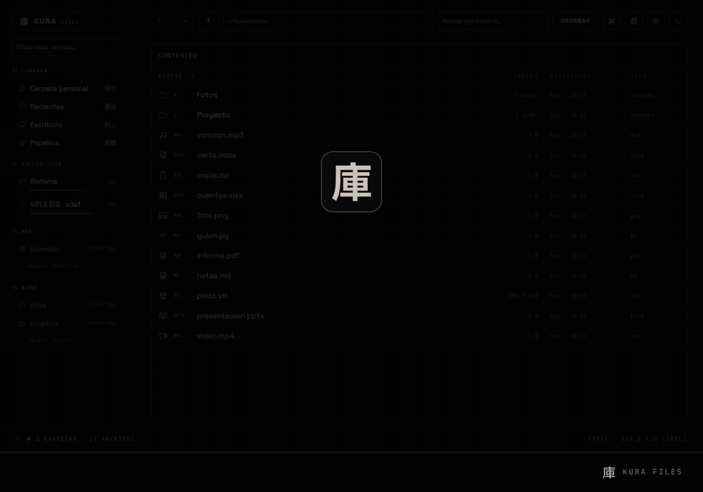
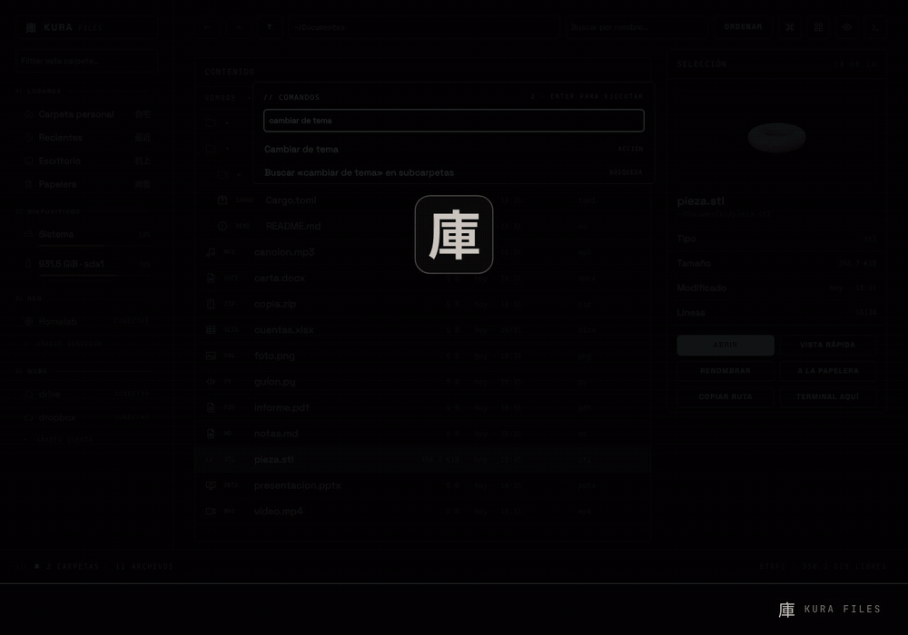
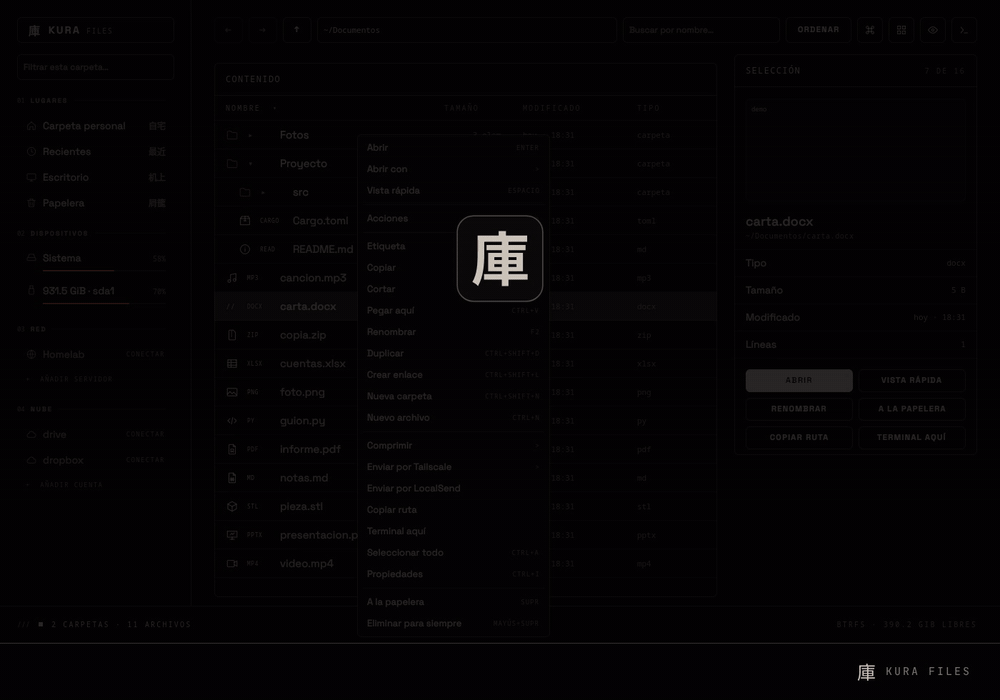
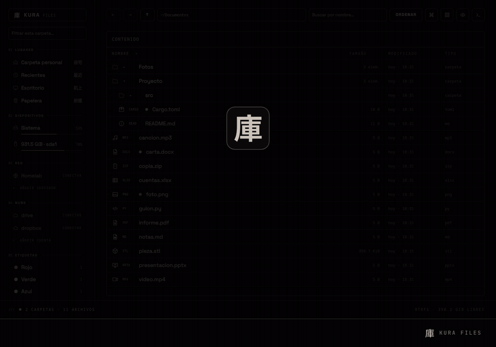
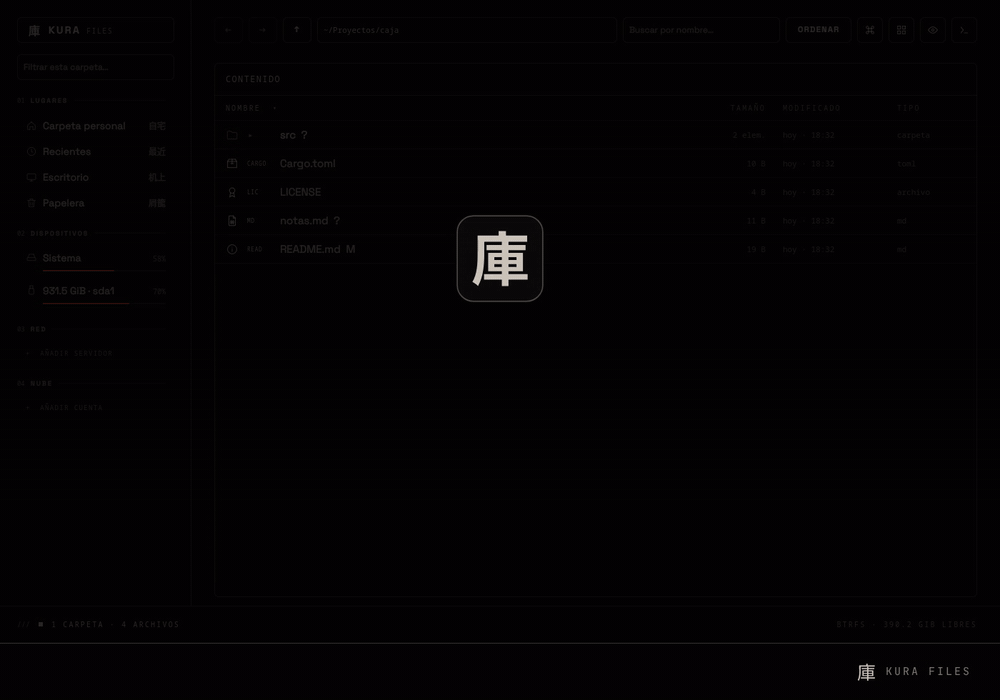

# Kura Files 庫

Gestor de archivos de escritorio para Linux: interfaz en QML sobre Quickshell y un motor en Rust sin dependencias. Funciona en cualquier compositor Wayland.


## En movimiento

**Un vistazo:** lista con iconos por tipo, carpetas que se abren en su sitio, cuadrícula y paleta de órdenes.



**Temas:** se cambian desde la paleta o desde Ajustes, y cada quien puede escribir el suyo.



**Acciones y etiquetas:** el clic derecho, las etiquetas de color y la instalación de acciones desde un repositorio.



**Nube y servidores:** las cuentas se abren como carpetas y un servidor se añade con un formulario.



**Repositorios:** lo modificado va marcado, y la paleta clona, trae, envía y guarda cambios.



## Qué hace

- Lista, lista compacta, cuadrícula y galería, con miniaturas y vista rápida.
- Pestañas, doble panel, marcadores, recientes y papelera con restaurar.
- Copiar, mover, renombrar (también en lote), duplicar, enlazar, comprimir y extraer, con deshacer y rehacer. Nunca sobrescribe.
- Búsqueda por nombre, dentro del contenido y en toda la carpeta personal con índice (hace falta `plocate`), filtro por tipo y orden por nombre, tamaño, fecha o tipo.
- Más de 900 extensiones reconocidas, con icono, color y etiqueta.
- Discos y servidores de red (SFTP y otros por GVFS).
- Cuentas en la nube (Drive, Dropbox, OneDrive, iCloud y las demás que conoce `rclone`), como carpetas.
- Envío de archivos por Tailscale y LocalSend.
- Repositorios de git: marca lo modificado, y desde la paleta clona, trae, envía y guarda cambios, o abre la página del repositorio.
- Paleta de comandos (Ctrl+K) y hoja de atajos (F1).
- Atiende «mostrar en carpeta» de otros programas (`bin/archivos-servicio`).
- Sirve de selector de archivos para otros programas a través del portal del escritorio (`bin/archivos-portal`).

## Acciones

El clic derecho ofrece los menús de servicio que entiende Dolphin (`kio/servicemenus`) y los que pongas en `~/.config/archivos/acciones/`. Uno propio es un archivo `.desktop`:

```ini
[Desktop Entry]
Type=Service
MimeType=image/*;
Actions=a-jpg;

[Desktop Action a-jpg]
Name=Convertir a JPG
Exec=magick %f %f.jpg
```

`%f` es el primer archivo, `%F` todos, `%d` su carpeta y `%n` su nombre.

También aparecen ahí los scripts de `~/.local/share/nautilus/scripts`, que reciben la selección como argumentos.

Un repositorio de scripts se instala entero desde la paleta de comandos, con «Instalar acciones desde un repositorio»: se clona en `~/.local/share/archivos/acciones/` y sus programas pasan al mismo menú. Desde ahí también se actualiza o se quita.

## Idiomas

La ventana está escrita en español y trae inglés. Usa el idioma del sistema, o el que elijas en Ajustes → Idioma.

Un idioma es un archivo `idiomas/<código>.json` que da a cada texto en español su traducción. Para añadir uno:

```sh
archivos idioma > idiomas/pt.json     # plantilla con todos los textos, sin traducir
archivos idioma pt                    # lo que todavía le falta
```

Rellena las traducciones, pon el nombre del idioma en `"name"` y envía el archivo en un pull request. Lo que quede vacío se muestra en español, así que un idioma a medias ya sirve. Mientras traduces puedes dejarlo en `~/.config/archivos/idiomas/`: se recarga al guardar.

## Requisitos

Linux con [Quickshell](https://quickshell.org) (probado con la 0.3.1) en cualquier compositor Wayland: Hyprland, Niri, Sway, KDE u otro. No depende de ningún escritorio concreto.

- Para compilar el motor: Rust.
- En el sistema: `gio` (GLib y GVFS), `bsdtar`, `sha256sum`, `wl-clipboard` y `jq`.
- Opcionales: `rclone` para la nube, `plocate` para la búsqueda con índice, `git` para instalar acciones, `tailscale` y `localsend` para enviar archivos, y Python con PyGObject para los dos servicios.
- Tipografías: Space Grotesk y SpaceMono Nerd Font; si faltan, se usan las del sistema.

## Aspecto

Los colores siguen la paleta que el escritorio saca del fondo de pantalla, si publica una: la de pywal (`~/.cache/wal/colors.json`) o la propia de algunos escritorios. Sin ninguna, usa un tema oscuro propio.

### Temas

Un tema es un archivo `.json` que cambia colores, tipografía, redondeo de las esquinas y el lado del panel. Vienen tres de ejemplo en `temas/` (Claro, Medianoche y Terminal) y se eligen en Ajustes → Tema o desde la paleta de comandos.

Para hacer uno propio, deja un archivo en `~/.config/archivos/temas/`, por ejemplo `mio.json`:

```json
{
    "name": "Mío",
    "follow": false,
    "paper": "#101418", "paperLift": "#161b21",
    "ink": "#e6e1d8", "inkDim": "#a9a399",
    "bone": "#e6e1d8", "inkOnBone": "#101418",
    "sun": "#f2a65a",
    "ui": "Inter", "mono": "JetBrains Mono",
    "radius": 10, "border": 1, "railWidth": 268, "rail": "left",
    "hues": { "pdf": "#ff8a8a", "image": "#ffd27a" }
}
```

Todas las claves son opcionales. `follow: false` hace que el tema no tome colores del fondo de pantalla; `rail` admite `left` o `right`; `hues` cambia el color de un tipo de archivo por el nombre de su icono (`pdf`, `image`, `video`, `music`, `code`, `archive`…). Los cambios en el archivo se ven al guardarlo.

Además, cualquier valor se puede fijar por encima del tema en `~/.config/archivos/tema.json`:

```json
{ "paper": "#0b1626", "ink": "#cfe0f5", "sun": "#6ea8ff", "ui": "Inter", "mono": "JetBrains Mono", "scale": 1.1 }
```

Admite las mismas claves que un tema, y además `scale`.

## Instalación

Primero, lo que necesita. Las listas de paquetes son orientativas: los nombres cambian entre versiones.

```sh
# Arch y derivadas
sudo pacman -S quickshell rust glib2 gvfs libarchive jq wl-clipboard python-gobject plocate

# Debian y Ubuntu (Quickshell no está empaquetado: se compila aparte)
sudo apt install cargo libglib2.0-bin gvfs gvfs-backends libarchive-tools jq wl-clipboard python3-gi plocate

# Fedora (Quickshell está en COPR)
sudo dnf install cargo glib2 gvfs bsdtar jq wl-clipboard python3-gobject plocate
```

Después:

```sh
git clone https://github.com/safloresmo/kura-files
cd kura-files
./instalar
```

`./instalar` compila el motor, pone la orden `archivos` en `~/.local/bin` y añade el lanzador. No escribe nada fuera de tu carpeta personal. Con `--servicios` añade «mostrar en carpeta» y el selector de archivos para otros programas; con `--por-defecto` lo deja como gestor de archivos; con `--quitar` lo deshace todo menos tus ajustes.

## Uso

```sh
archivos [carpeta]     # abre la ventana
archivos ayuda         # el resto de órdenes
archivos compilar      # vuelve a compilar el motor tras actualizar
archivos pruebas       # pruebas del motor y de la ventana
```

## Licencia

MIT. Consulta `LICENSE`.
